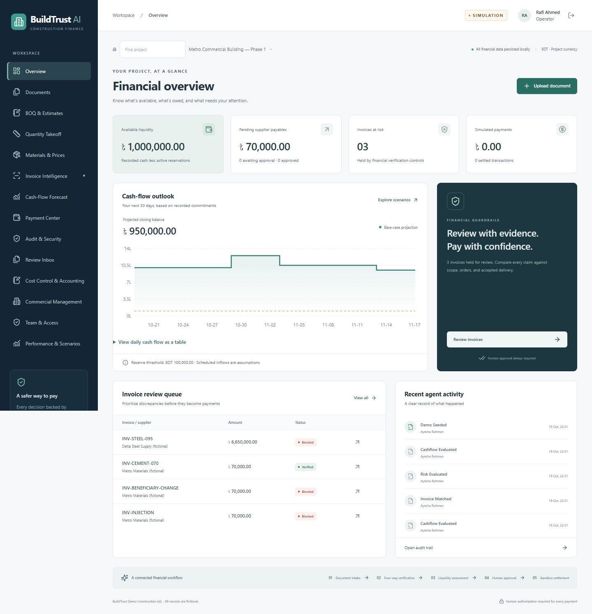
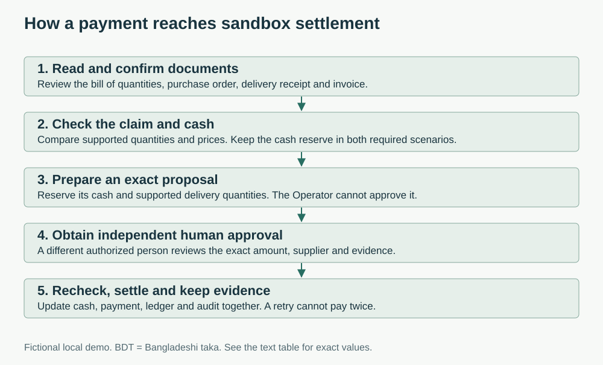
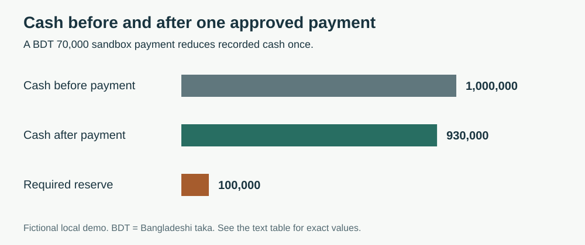
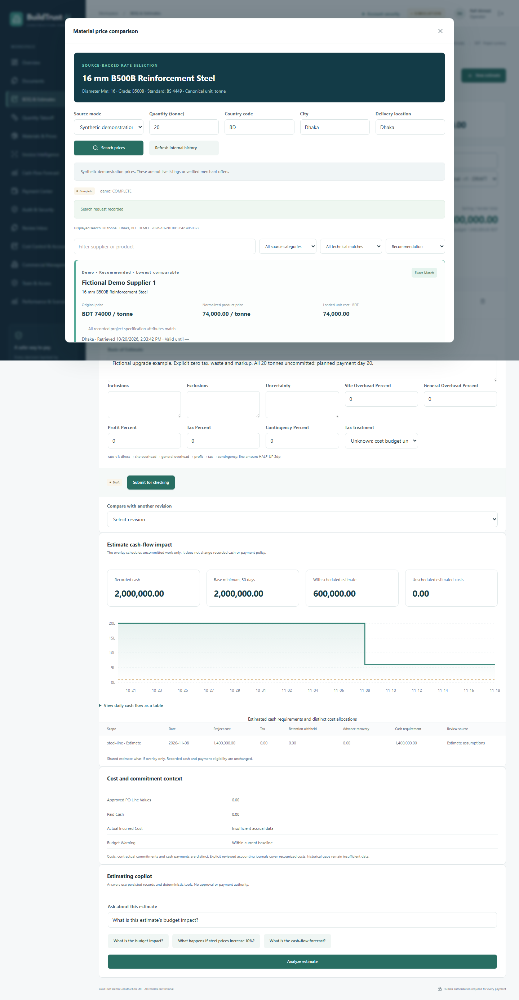
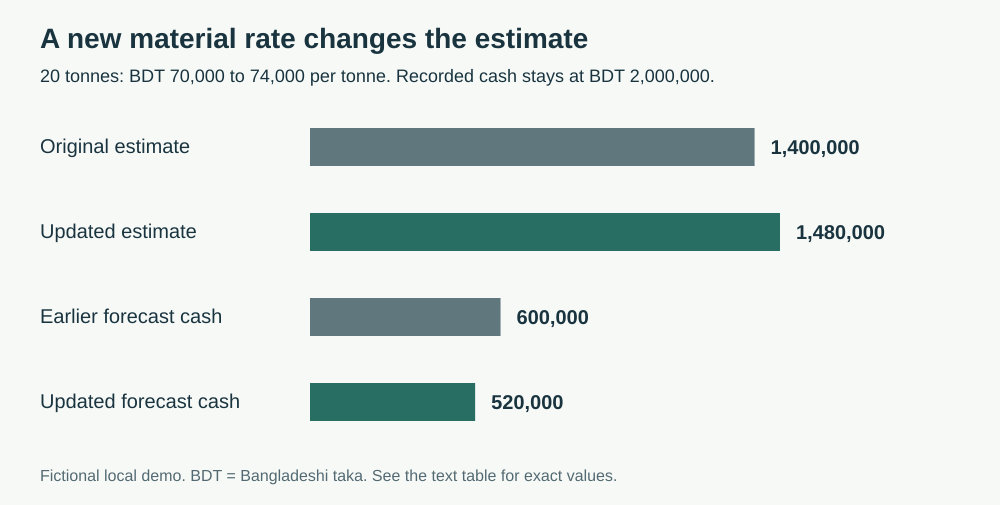
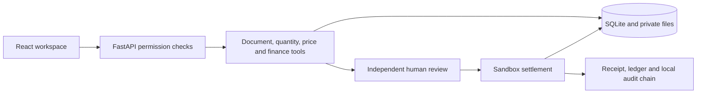

# BuildTrust AI

**See why a construction payment is safe before you approve it.**

A supplier claims 95 tonnes of steel. The records support 80. BuildTrust AI shows the difference, explains the BDT 1,050,000 excess and blocks the payment. A valid BDT 70,000 invoice follows a different path: a person reviews it, another person approves it, and the app records one simulated payment.

The same workspace helps your team measure work, compare material prices and see how a changed estimate affects future cash. Every financial action keeps its supporting evidence.

**Implemented and verified on October 20, 2026.** The local application and its security hardening are complete for the judge package. [Windows and Linux checks passed](https://github.com/md-ishtiak-ahmed-sajib/buildtrust-ai/actions/runs/39419213954) for application revision `0009a19`. External service trials, professional review and team submission actions remain separate.

[All features](features.md) · [Documentation](docs/README.md) · [Test evidence](docs/completion-verification.md) · [Remaining work](docs/remaining-work.md)



*Actual app screenshot from a fictional test project. Your new demo may show different dates and record IDs.*

## Choose your first look

| Your time | A useful place to start |
|---|---|
| One minute | [Project overview](docs/project-overview.md): the problem, the working solution and its results |
| Five minutes | Start the public demo below and follow the two walkthroughs |
| A detailed review | [Features](features.md), [security report](docs/security-self-assessment.md) and [technical guide](docs/technical-documentation.md) |

## Try the public demo

You need Windows, [Python 3.12](https://www.python.org/downloads/), [uv](https://docs.astral.sh/uv/getting-started/installation/) and [Node.js 24](https://nodejs.org/). Git is needed if you clone the repository. The first setup downloads the locked dependencies. After setup, the default demo works without paid services.

1. Download this repository, or clone it:

   ```powershell
   git clone https://github.com/md-ishtiak-ahmed-sajib/buildtrust-ai.git
   cd buildtrust-ai
   ```

2. Start the separate public demo:

   ```powershell
   .\scripts\try_demo.ps1
   ```

   If Windows blocks the script, use:

   ```powershell
   powershell -NoProfile -ExecutionPolicy Bypass -File .\scripts\try_demo.ps1
   ```

3. Open **http://127.0.0.1:8003**. Keep the terminal open. Press **Ctrl+C** to stop it.

The launcher installs missing dependencies, builds the app and prepares `data/public-demo`. Later starts keep that demo's records. It does not use your ordinary `data/buildtrust.db`, change private passwords or reset your working app. If port 8003 is occupied, close the existing demo before trying again.

If you changed a public account's role or password, startup will refuse to replace it. Stop that demo and keep its `data/public-demo` folder under a backup name before starting a fresh sample. Never remove your private `data/buildtrust.db`. If only the sample payment was already completed, inspect its receipt or use Admin's demo reset; older runs remain in history.

### Public demo logins

These four passwords are intentionally public. They work in the **separate public demo on port 8003**. They are not the passwords for an existing private installation on port 8000.

| Role | Login ID | Public demo password | What to try |
|---|---|---|---|
| Operator | `operator@buildtrust.demo` | `BuildTrust-Operator-2026!` | Upload, measure, estimate and prepare a payment |
| Finance Manager | `manager@buildtrust.demo` | `BuildTrust-Manager-2026!` | Check records; approve and execute payments up to BDT 100,000 |
| Admin | `admin@buildtrust.demo` | `BuildTrust-Admin-2026!` | Approve independently checked budgets and controls; payment limit BDT 1,000,000 |
| Auditor | `auditor@buildtrust.demo` | `BuildTrust-Auditor-2026!` | Read records, receipts and audit evidence |

Private Admin and Finance Manager accounts require an authenticator. The separate public demo is exempt, so the four passwords above keep working. See [account security](docs/account-security.md) for setup and owner-only recovery.

Passwords come from [one public sample file](demo/public-accounts.json). Private passwords, signing secrets and databases stay out of Git and the source archive. The public launcher disables paid price services and uses the built-in explanation tools.

**A person cannot approve their own payment.** An estimate needs a preparer, a different checker and a separate Admin approver. Sign out before changing accounts. Refreshing the browser requires another login because tokens stay in memory.

## First walkthrough: check and pay an invoice

Start with the **Operator** account and the Metro Commercial Building project.

1. Open **Invoice Intelligence** and select `INV-STEEL-095`.
2. Run the financial workflow. The invoice claims 95 tonnes, but the records support 80. The excess is **BDT 1,050,000**, or **18.75%**. Payment is blocked.
3. Select `INV-CEMENT-070` and run its workflow. The supported amount is **BDT 70,000**. Open the prepared payment.
4. Sign out. Sign in as **Finance Manager**, open **Payment Center**, approve the proposal and choose **Execute simulation**. Confirm each action.
5. Read the mock receipt. Cash changes from **BDT 1,000,000 to BDT 930,000** once. Open **Audit & Security** and verify the chain.



The app checks four records: the **bill of quantities (BOQ)**, **purchase order (PO)**, **accepted delivery receipt (GRN)** and **invoice**. An uploaded file cannot approve itself.



| Verified fictional payment | BDT |
|---|---:|
| Cash before payment | 1,000,000 |
| Approved simulated payment | 70,000 |
| Cash after payment | 930,000 |
| Required minimum reserve | 100,000 |

These values come from [actual HTTP scenario B](submission/execution-evidence/scenario-b.json). The separate Liquidity Stress Case shows why a valid invoice can still be blocked when cash would fall below the reserve.

## Second walkthrough: compare prices and update an estimate

1. Sign in as **Admin**. In **Materials & Prices**, choose **Create / locate upgrade demo**.
2. Select **Price & QS Upgrade — Fictional Demo** in the project menu.
3. Sign in as **Operator**, choose that project and open **BOQ & Estimates**.
4. Click the steel material. In the comparison drawer, select **Synthetic demonstration catalogue** and search.
5. Select the eligible **BDT 74,000 per tonne** offer. Review the change and confirm it. A cheaper offer with the wrong grade is blocked.
6. Submit the estimate. Sign in as **Finance Manager** to check it, then as **Admin** to approve it. A contributor cannot provide their own independent review.





| Verified fictional estimate | Before | After |
|---|---:|---:|
| Steel quantity | 20 tonnes | 20 tonnes |
| Rate per tonne | BDT 70,000 | BDT 74,000 |
| Estimate cost | BDT 1,400,000 | BDT 1,480,000 |
| Forecast cash after the scheduled purchase | BDT 600,000 | BDT 520,000 |
| Recorded cash | BDT 2,000,000 | BDT 2,000,000 |

The estimate rises by **BDT 80,000**. A forecast does not move cash or approve payment. Demo tax, retention and markup are explicitly zero in this example.

## What is included?

The app has **14 areas**. See [features.md](features.md) for the full feature and role tables.

| Work | Main areas |
|---|---|
| Check project records | Overview, Documents, Invoice Intelligence, Audit & Security |
| Plan quantities and prices | Quantity Takeoff, Materials & Prices, BOQ & Estimates |
| Review money | Cash-Flow Forecast, Payment Center, Cost Control & Accounting |
| Manage reviews and contracts | Review Inbox, Commercial Management, Team & Access |
| Compare project performance | Performance & Scenarios |

The built-in copilot explains saved evidence. It can help prepare drafts. It cannot approve or execute a payment.

## How the app works



[Image version of the architecture](docs/assets/architecture.svg). The database stores money as integer minor units. The server uses Decimal arithmetic and checks current roles, project access, versions, cash and approval evidence before financial writes.

## Use your private working copy

For the original private profile on **http://127.0.0.1:8000**, run:

```powershell
.\scripts\setup.ps1
.\scripts\run_demo.ps1
```

This setup generates random passwords in `data/demo-credentials.json`. It does not use the public password table. Keep `data/` and `.env` private. The public demo is convenient for fictional trials; it is not a public hosting configuration.

Defaults: BDT currency, Asia/Dhaka business dates, BDT 100,000 reserve, 30-minute payment approvals and a 15-day delayed-receivables check. Base and delayed scenarios must both keep the reserve. A cost-pressure shortfall produces a warning.

## Implemented, checked and ready to explore

The security work is implemented. Private Admin and Finance accounts use authenticator MFA. The server checks project access and permissions on every protected request, protects uploads and browser actions, keeps secrets private and rejects replayed recovery codes.

| Executed local check | Result |
|---|---|
| Backend tests | 251 passed |
| Frontend tests | 10 passed |
| Browser workflows | 20 passed |
| Public demo browser logins | All four passed without MFA |
| Original payment scenarios A–H | All eight passed |
| Build, secret scans, dependency audits and backup/restore | Passed within the recorded scope |

[Hosted Windows and Linux checks also passed](https://github.com/md-ishtiak-ahmed-sajib/buildtrust-ai/actions/runs/39419213954). Each runner passed 250 backend tests and skipped the optional OCR model test because its language files were absent. The local Windows run included that test and passed all 251. Read [the evidence guide](docs/completion-verification.md) for dates, source revisions and limits.

The newer security checklist has **17 verified controls**, **one deferred control** (native database RLS) and **one not applicable control** (disabled incoming webhooks). These are evidence labels, not a security score.

Use isolated checks so your working records stay separate:

```powershell
uv run --project backend pytest backend/tests
npm --prefix frontend test
npm --prefix frontend run build
uv run --project backend python scripts/verify_upgrade_browser.py
uv run --project backend python scripts/collect_evidence.py --output data/my-api-evidence
```

The first browser run needs Chromium: `npm --prefix frontend exec playwright install chromium`. Avoid running browser tests directly against your working app. The isolated wrappers create their own databases and servers.

## Documentation, submission and limits

- [Documentation index](docs/README.md) and [plain-English glossary](docs/glossary.md)
- [All features](features.md), [judge guide](docs/judges-quickstart.md) and [financial rules](docs/financial-rules.md)
- [Technical guide](docs/technical-documentation.md), [API guide](docs/api-reference.md) and [security review](docs/security-self-assessment.md)
- [Submission files and reading guide](submission/README.md)
- [Execution-evidence ZIP](submission/BuildTrustAI_Execution_Evidence.zip) and [delivery checksums](submission/checksums.json)
- [Presentation](submission/BuildTrustAI_Presentation.pptx), [demo video](submission/BuildTrustAI_Demo.mp4), [source archive](submission/BuildTrustAI_Source.zip) and [submission checklist](submission/submission-checklist.md)
- [Remaining tasks and their owners](docs/remaining-work.md)

Paid price services need keys and separate live checks. OCR needs local models and human review. Professional standards, representative Bengali documents, assistive-technology assessment and unavailable platforms still need their own evidence. A local audit chain can detect inconsistent records, but a person with full database access can rewrite it. Read the [limits](docs/limitations.md) before considering deployment.

## License

**AGPL-3.0-only.** See [LICENSE](LICENSE) and [dependency attribution](THIRD_PARTY_NOTICES.md). This project retains PyMuPDF under its open-source license.

Private accounts support server-side sign-out, password changes and one-time offline recovery. The four public demo passwords above stay fixed. See [account security and private backups](docs/account-security.md) and the [20-item security review](docs/security-self-assessment.md).
