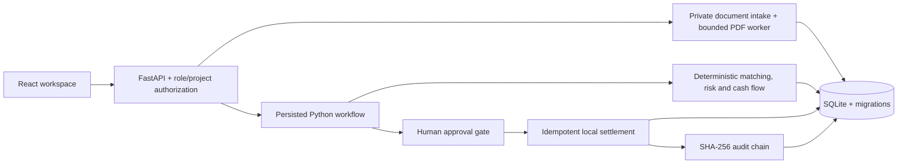

> Current local release: 191 backend tests, 8 frontend tests, 16 browser workflows and A–H HTTP scenarios passed. Read [completion verification](docs/completion-verification.md), [remaining external/human tasks](prompt/Not%20implemented.md) and the [submission checklist](submission/submission-checklist.md). Repository: [md-ishtiak-ahmed-sajib/buildtrust-ai](https://github.com/md-ishtiak-ahmed-sajib/buildtrust-ai).

# BuildTrust AI

Current development includes reviewed accounting, invoice installments, supplier changes, optional local OCR, expanded takeoff, and sourced cost performance. Open **Review Inbox**, **Cost Control & Accounting**, **Commercial Management**, **Team & Access**, or **Performance & Scenarios** in the application. Commercial certificates, split invoice allocations and automatic local job recovery now share the existing approval and audit controls. The local implementation and separate external prerequisites are recorded in [implementation status](docs/all-suggestions-implementation.md) and [current controls and limits](docs/accounting-and-controls.md).

**An autonomous construction finance copilot with explicit human payment authorization.**

BuildTrust AI compares approved bills of quantities, purchase orders, accepted delivery records, and supplier invoices before preparing a payment. It checks available cash and a 30-day liquidity projection, routes an exact proposal to a different authorized person, and settles only in a local sandbox.

2026 Shenzhen FinTechathon · International Track · Topic E: SME Finance Copilot

> Every company, supplier, beneficiary token, invoice, and transfer in the demo is fictional. There is no bank connection. A `MOCK-…` reference is a simulated transaction ID.


## Quick start on Windows

Install [Python 3.12](https://www.python.org/downloads/), [uv](https://docs.astral.sh/uv/getting-started/installation/), and [Node.js 24](https://nodejs.org/). From this directory:

```powershell
.\scripts\setup.ps1
.\scripts\run_demo.ps1
```

Open **http://127.0.0.1:8000**. Setup installs the locked dependencies, builds the frontend, migrates SQLite, and seeds fictional data. Initial setup requires package downloads; the default application needs no external service after installation. If PowerShell blocks local scripts, invoke the reviewed script using `powershell -ExecutionPolicy Bypass -File .\scripts\setup.ps1`.

The judge launcher serves the application and API from one process. Keep its terminal running; Ctrl+C stops it. For development, run `scripts/run_dev.ps1` and open http://127.0.0.1:5173. Vite proxies the API to port 8000.

### Demo accounts

Setup generates unique local passwords and prints them. They are saved in **`data/demo-credentials.json`**, which is excluded from source control and the source archive.

| Email | Role | Financial authority |
|---|---|---|
| `operator@buildtrust.demo` | Operator | Intake, correction, analysis, proposal preparation |
| `manager@buildtrust.demo` | Finance Manager | Procurement confirmation; independent approval/execution up to BDT 100,000 |
| `admin@buildtrust.demo` | Admin | BOQ/variation confirmation; approval/execution up to BDT 1,000,000 by default |
| `auditor@buildtrust.demo` | Auditor | Read-only records, receipts, and integrity verification |

The same account cannot create and approve a proposal. Sign out and sign in with the manager account for the successful payment demonstration. Tokens are kept in browser memory; refreshing the page requires signing in again.

## Demonstration

1. Open **Invoice Intelligence** and select `INV-STEEL-095`. The 95-tonne claim exceeds supported delivery of 80 tonnes by **BDT 1,050,000 (18.75%)**. Run its workflow and inspect the source records; payment stays blocked.
2. Select `INV-CEMENT-070` and run the workflow as Operator. The BDT 70,000 invoice passes the four-way and liquidity checks. Open the prepared payment.
3. Sign out, sign in as Finance Manager, and open **Payment Center**. Approve the exact proposal, then confirm **Execute simulation**.
4. Inspect the mock receipt: the project balance changes from **BDT 1,000,000 to BDT 930,000** once. Inspect the cash-flow scenarios and verify the audit chain.
5. Select **Liquidity Stress Case — Demo Project** to see a compliant BDT 70,000 invoice held because BDT 150,000 cash would fall to BDT 80,000 against a BDT 100,000 reserve.
6. Inspect the beneficiary-change and instruction-injection invoices. Both are held. Admin can reset the demo from **Audit & Security**; earlier runs and their audit events remain stored.

The `demo/fixtures/` directory contains nine source documents in **PDF, CSV, and JSON** formats. Renaming a file does not change its parsed contents. PDF extraction requires human field review; generic or scanned layouts can be entered manually. See [the document format](demo/README.md).

## Architecture



The frontend uses React, TypeScript, Vite, Tailwind, React Router, TanStack Query, Recharts, and Lucide. The backend uses FastAPI, Pydantic, SQLAlchemy, Alembic, PyMuPDF, Argon2, PyJWT, and exact financial arithmetic. Money is stored as integer minor units and returned as decimal strings. Quantities and rates use Decimal; browser chart numbers never authorize payments.

## Price intelligence, QS and estimates upgrade

The app now also provides **BOQ & Estimates**, **Quantity Takeoff**, and **Materials & Prices**.
Estimates are versioned separately from approved procurement and never rewrite settled cash.
See [upgrade architecture/plan](docs/advanced-upgrade-plan.md), [provider configuration](docs/price-source-integrations.md),
[measurement support](docs/quantity-surveying-standards.md), and [estimating formulas](docs/estimating-methodology.md).

To try the new workflow:

1. Sign in as Admin, open Materials & Prices, and click **Create / locate upgrade demo**.
2. Choose **Price & QS Upgrade — Fictional Demo** in the project selector.
3. Sign in as Operator, choose that project, open BOQ & Estimates, and click its steel material.
4. Select **Synthetic demonstration catalogue**, search, and choose the recommended eligible offer.
5. Review the server-calculated preview and confirm. The estimate changes from BDT 1,400,000 to
   BDT 1,480,000; its scheduled cash preview changes from BDT 600,000 to BDT 520,000.
   Recorded cash stays BDT 2,000,000. A cheaper wrong-grade offer is blocked.
6. Submit as Operator, check as Finance Manager, then approve as a different Admin.
   Approved versions retain complete evidence snapshots; create a revision to edit them.

For online searches, configure the optional SerpApi/DataForSEO keys locally and restart.
No live paid-provider check is claimed without keys; results depend on local market coverage.
Official schedules, historical rates and synthetic data are visibly different source categories.
An online listing is never silently treated as a verified supplier quotation.

SQLite startup takes an online backup before upgrading a populated schema. To rehearse
migration/recovery on a separate copy, run `uv run --project backend python scripts/verify_upgrade_migration.py`.

## Configuration and data

Copy `.env.example` to `.env` to override defaults. Relative data paths resolve against this repository, consistently across launch scripts. Runtime files live in `data/` by default: database, private uploads, generated signing secret, and local credentials. Do not publish that directory.

Defaults: BDT 100,000 minimum reserve; BDT 100,000 manager limit; BDT 1,000,000 Admin ceiling; 30-minute approval validity; 15-day receivables delay; 10% future-cost pressure. Both base and delayed-receivables scenarios must preserve the reserve. Scenario preview controls do not alter the payment policy.

The default explanation provider is deterministic. To use an existing local Ollama installation, set `BUILDTRUST_LLM_PROVIDER=ollama`, `BUILDTRUST_OLLAMA_MODEL` to an installed model, and optionally `BUILDTRUST_OLLAMA_URL`. The adapter calls `/api/chat`; timeouts, unavailable providers, or invalid references fall back to deterministic explanations. LLM output never controls amounts, approvals, permissions, or settlement.

`BUILDTRUST_DEMO_MODE=false` disables reset. This does not convert the application into a production banking system; its payment executor remains a simulation.

## Verification and evidence

```powershell
.\scripts\run_tests.ps1
uv run --project backend python scripts\collect_evidence.py --output data/advanced-api-evidence
```

The evidence collector starts its own server on port 8001 with a separate persistent database, executes A–H over real HTTP, asserts independent expected results, and writes JSON, Markdown, and operation logs to `submission/execution-evidence/`. It does not change the judge workspace database. Evidence database files remain private in `data/evidence-*/`.

Browser checks require the judge server running:

```powershell
npm --prefix frontend exec playwright install chromium
npm --prefix frontend run test:e2e
```

For an isolated run of both old and new browser checks, use
`uv run --project backend python scripts/verify_upgrade_browser.py`. It creates a separate
database/server and saves actual screenshots/logs under `data/advanced-browser-*`.
Running `test:e2e` directly targets the configured server and may reset its fictional data.
New screenshots default to `data/`, preserving existing submission files.
See [upgrade validation](docs/advanced-feature-tests.md) and [baseline results](docs/test-results.md).

The live API reference is http://127.0.0.1:8000/docs. [Exported OpenAPI](docs/openapi.json) and generated TypeScript contracts are included. Regenerate them with `scripts/export_contracts.py` followed by `npm --prefix frontend run types:api`.

## Optional Docker path

```powershell
docker compose up --build
docker compose exec buildtrust cat /source/data/demo-credentials.json
```

Docker Compose binds port 8000 to loopback and uses a persistent volume. Docker validation status is recorded in the test results; Windows native startup is the primary delivery path.

## Documentation and submission

The `submission/` package is refreshed from the verified release. Artifact receipts and unresolved human details are recorded in its submission checklist.

- [Technical documentation](docs/technical-documentation.md), [financial rules](docs/financial-rules.md), and [API reference](docs/api-reference.md)
- [Security self-assessment](docs/security-self-assessment.md), [threat model](docs/threat-model.md), and [limitations](docs/limitations.md)
- [Judge quickstart](docs/judges-quickstart.md), [demo script](docs/demo-script.md), and [presentation outline](docs/presentation-outline.md)
- [Submission checklist](submission/submission-checklist.md), execution evidence, screenshots, presentation, and recorded demonstration

The implementation is a construction-finance prototype. It supports documented source layouts, trusted human procurement confirmation, one cash account per project, and installments against an authoritative payable balance, with one settlement per proposal and bounded total payment. It is not a full accounting suite or a certified compliance product. See the limitations before extending deployment.

## License and attribution

AGPL-3.0-only; see [LICENSE](LICENSE). PyMuPDF is retained under its open-source license. See [third-party attribution](THIRD_PARTY_NOTICES.md). No regulatory certification, external financial offer, customer result, or independently anchored audit immutability is claimed.
