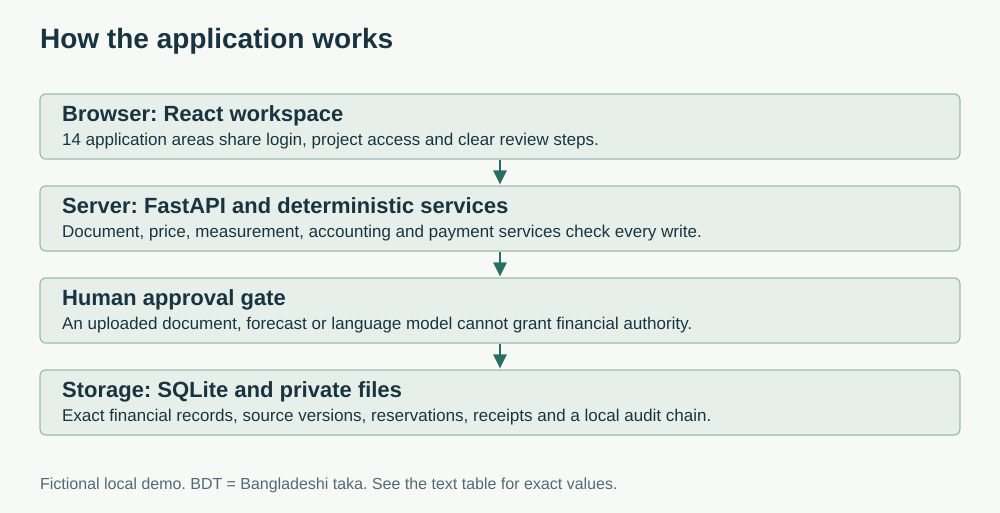

# How the app is built

The browser provides 14 application areas. FastAPI checks login, current roles and project access. Domain services calculate quantities and money. SQLite and private files keep evidence and financial records.

The editable [Mermaid diagram](architecture.mmd) shows detailed flows. See the [technical guide](technical-documentation.md) for setup and operations.

| Boundary | Responsibility |
|---|---|
| Browser | Forms, saved-record views, draft guards, charts and data tables |
| API routers | Validate requests, enforce access, own transactions and return typed errors |
| Documents | Private storage, bounded parsing/OCR, field revisions and human confirmation |
| Pricing/measurement | Saved searches, matching, reviewed quantities and price evidence |
| Estimating | Versioned BOQs, rate components, selections and independent budget approval |
| Accounting/commercial | Cost recognition, balances, contracts, certificates, amendments and corrections |
| Payments | Reservations, approval rechecks, limits, liquidity, idempotency and atomic settlement |
| Audit/jobs | Linked events, integrity checks, saved attempts, leases and restart recovery |

Routers are split by documents, invoices, payments, workflows, prices, measurement, estimates, controls, reports, operations and administration. Model modules share one SQLAlchemy Base. Pages load as needed. The estimate editor has separate BOQ, rate, basis and forecast components.

The database is the financial source of truth. Chart numbers and optional AI prose cannot authorize payment. Budgets do not rewrite procurement authority. Corrections use compensating records instead of editing history.
