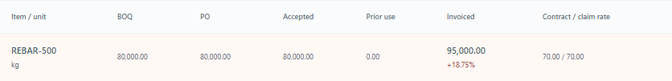

# BuildTrust AI: a decision you can explain

**Construction finance with evidence at every step.**

A payment request should answer a simple question: what supports this amount? BuildTrust AI puts the approved scope, purchase order, accepted delivery and supplier invoice side by side. It checks the claim and the cash, then asks an independent person to approve the exact payment.

The application is implemented. Its security hardening and recorded checks are complete for the local judge package. It uses fictional projects and simulated settlement. No bank, card or real money is connected.

## Three examples you can trace

| Example | What happens in the app |
|---|---|
| An inflated invoice | 95 tonnes claimed, 80 supported. The app identifies BDT 1,050,000 excess and blocks payment. |
| An eligible payment | A different person approves BDT 70,000. Cash changes from BDT 1,000,000 to 930,000 once. A repeated execution returns the same receipt. |
| A changed material rate | Twenty tonnes at BDT 74,000 instead of 70,000 increases the estimate by BDT 80,000. Forecast cash changes from 600,000 to 520,000. Recorded cash remains 2,000,000. |

These are tested fictional examples. Their source records, outputs and audit references are included in the execution evidence.

## One workspace for the project team

The 14 application areas connect document review with quantity surveying, prices, estimates, contracts, accounting, forecasts and payment evidence. Operators prepare work. Finance Managers check it. Admins approve eligible actions independently. Auditors read the records and verify the local audit chain.

An estimate approval creates a budget baseline. It does not change an existing purchase order or authorize a payment. Forecasts keep recorded cash separate from expected receipts. Missing cost evidence and dates remain visible.

## Security is implemented

Private Admin and Finance accounts require an authenticator. The public demo keeps four fixed README passwords and does not require MFA. Its database and files are separate from the private workspace.

The backend checks current sessions, roles and project access. It recalculates financial decisions from saved records. Upload validation, safe browser requests, outbound-provider restrictions, secret scanning, usage caps and private backup/restore have recorded acceptance evidence.

| Executed check | Result |
|---|---|
| Local backend suite | 251 passed |
| Frontend tests | 10 passed |
| Private browser workflows | 20 passed |
| Public demo browser logins | Four passed without MFA |
| Payment HTTP scenarios | A–H all passed |
| Hosted Windows and Linux | Both passed. Each skipped one optional OCR test because its language files were not installed. |

The [October 20 hosted run](https://github.com/md-ishtiak-ahmed-sajib/buildtrust-ai/actions/runs/39419213954) identifies tested application revision `0009a198bf9ce7583cd2c870953e21d82a584739`. Later documentation changes retain the same application behavior. The publication receipt beside the source archive records the final package and its matching checks.

The 19-control security checklist records 17 verified controls. Native database row-level security is deferred while SQLite is used. Incoming webhooks are disabled, so signature verification is not applicable. A local database owner can rewrite the audit chain. These checks do not replace an independent security assessment or establish public-deployment readiness.

## A quick route through the submission

1. Read this overview and watch the 4:18 demonstration.
2. Open the nine-slide presentation and its speaker notes.
3. Try the separate public demo using the command and four passwords in the README.
4. Read the technical and security reports for the rules behind each screen.
5. Inspect the execution evidence and source archive to trace the results.

Repository: [BuildTrust AI on GitHub](https://github.com/md-ishtiak-ahmed-sajib/buildtrust-ai). [The README](../README.md) explains installation. [The feature guide](../features.md) shows the full workflow. [Remaining work](remaining-work.md) names the external reviews, optional service checks and human submission actions still needed.
