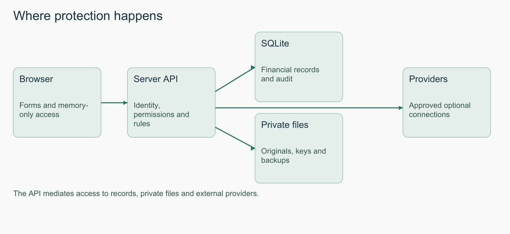
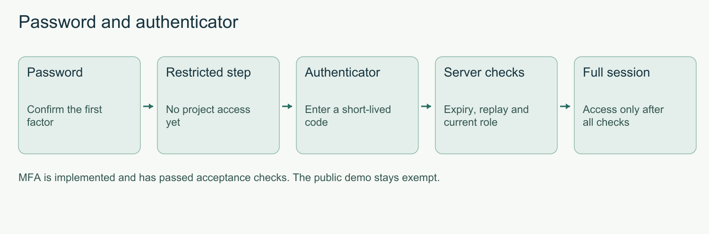
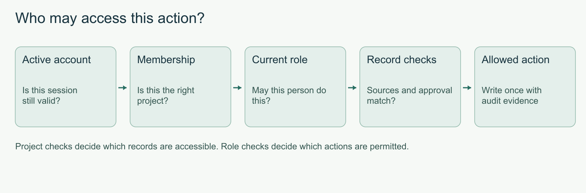
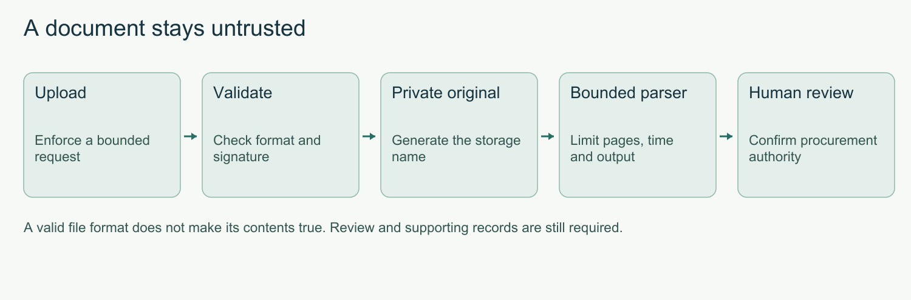
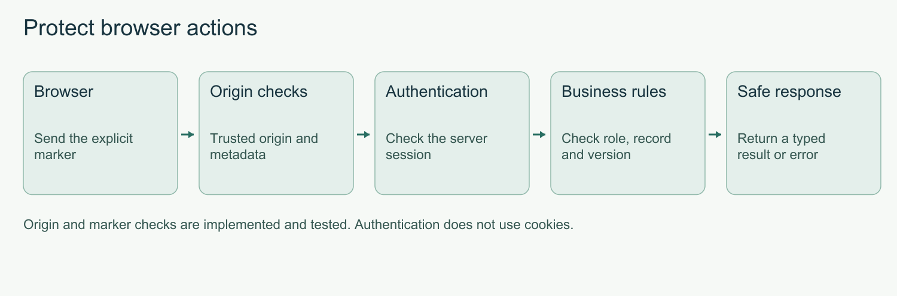
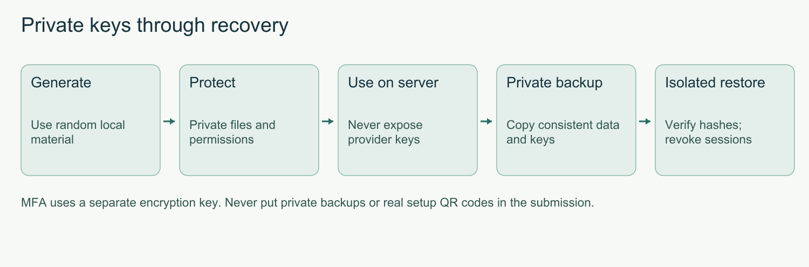

# Technical documentation

**The implemented system behind the demonstration.**

BuildTrust AI connects construction evidence to deterministic financial decisions. The React workspace sends requests to FastAPI, where current account, project, role and record checks protect each operation. SQLite stores exact money and linked evidence. Payments remain simulations.

The application and security hardening are implemented. Migration 0019, private privileged-account MFA, safe browser requests, bounded providers and backup/restore have passed the recorded acceptance checks. Hosted Windows and Linux checks passed on October 20. The following pages explain the working system and its limits.

## Profiles and installation

| Profile | Start | Data and login |
|---|---|---|
| Public fictional demo | `scripts/try_demo.ps1`; localhost port 8003 | `data/public-demo`; four public README passwords |
| Private workspace | `scripts/setup.ps1`, then `scripts/run_demo.ps1`; port 8000 | `data/`; generated private passwords |
| Development | `scripts/run_dev.ps1`; frontend port 5173 | Configured private data; Vite proxies API calls |
| Isolated verification | Test/evidence wrappers | Separate temporary or uniquely named data folders |

Use Python 3.12, Node.js 24 and uv. Setup installs locked dependencies and builds the frontend. Initial downloads are required. Default runtime operation needs no external model or paid API.

The public launcher requires a marked profile and expected accounts. It refuses unrelated data or changed accounts rather than overwriting passwords. Repeat startup keeps records. The public settings use built-in defaults and ignore private environment/.env values, including reserve, expiry, workers and parser bounds. Paid keys are disabled and explanations stay deterministic. Signing secrets remain random and private.

## Services and contracts

FastAPI composes focused routers and domain services. Models share one SQLAlchemy Base. Pydantic defines validated requests and authoritative responses. OpenAPI and frontend API types are generated from the app.

`POST /agent/analyze` saves a workflow and returns its ID. The UI polls saved steps. Analysis can prepare a proposal but stops for human approval. Expensive parsing and password work stay outside ordinary financial write locks. Publication rechecks authority and source versions.

## Financial storage

Money is stored as integer minor units and returned as decimal strings. Decimal calculations use ROUND_HALF_UP: money to two decimal places, published quantities/rates to six. Round line amounts before summing. Bound numeric length, digits and exponent before expansion.

Events use UTC timestamps. Business dates use Asia/Dhaka. BDT is the default currency. Estimating/reporting FX needs dated evidence; settlement does not convert currencies.

Users, memberships, suppliers, documents, revisions, procurement, acceptances, invoices, proposals, reservations, balances, payments, journals, workflows and audit retain source links. Estimate versions, observations/selections, measurements, controls and approvals keep their own evidence. Legacy receipt bodies and audit payloads are preserved.

## Deterministic financial decisions

Match the project, supplier, item code, specification and compatible units before comparing quantities. Supported quantity is the lowest remaining approved BOQ scope, effective PO authorization and confirmed accepted delivery, bounded at zero. Existing allocations and active reservations reduce those balances. Revalidation excludes the proposal's own reservation. One tonne is 1,000 kilograms; quantity and rate convert together.

Verified quantity cannot exceed the claim or supported quantity. The verified line uses the contracted PO rate and cannot exceed the remaining approved BOQ value. Round each line before summing explicit tax, retention and discount. Invoice text cannot change the approved supplier beneficiary. The steel example claims 95 tonnes against 80 supported: the 15-tonne excess is 18.75%, and BDT 1,050,000 is blocked.

Cash decisions use current recorded cash minus other live reservations. A payment needs cash now and must preserve BDT 100,000 on every day of both the 30-day base forecast and the 15-day receivables-delay scenario. Cost pressure produces a warning. Expected receipts are not settled cash. Canonical obligations and installment links count an outflow once; costs without dates remain unscheduled.

Approval binds the exact supplier, beneficiary, amount, currency, record versions, policy and expiry. A contributor cannot approve their own work. Payment approval normally lasts 30 minutes. Default ceilings are BDT 100,000 for Finance Manager and BDT 1,000,000 for Admin. Execution rechecks all rules and uses an idempotency key so an identical retry returns the original receipt.

Estimates keep cost and selling totals separate. Price selections preserve evidence snapshots. An approved estimate changes a budget baseline; it cannot change an existing PO, delivered quantity or settled payment. See [financial formulas and correction rules](financial-rules.md) for the full calculation reference.

## Transactions and upgrades

SQLite enables foreign keys, WAL and bounded lock waits. Financial writes use BEGIN IMMEDIATE. Settlement commits cash, payment, allocations, payable changes, ledger, receipt and success audit together. Failure rolls back money; denied/failed attempts are audited separately.

The migration head is **0019**. Migration 0018 adds sessions, password-recovery tokens, admission counters and usage reservations. Migration 0019 adds encrypted MFA factors, restricted challenges, recovery-code hashes and session assurance. Sign in again after upgrading; earlier tokens are rejected. Startup takes a consistent online backup before upgrading a populated database. Migration 0008 rebuilt payment constraints for installments; later migrations add procurement/correction records and indexes. Original payments, receipts and audit history remain unchanged. Rehearse backup, migration, integrity and recovery on a copy first.

## Documents, imports and OCR

Files are limited to 10 MB. The request envelope is bounded before multipart parsing. JSON depth/structure and import row/column counts are bounded. Required/duplicate headers are checked before rows. Failed imports leave drafts unchanged. XLSX formulas and oversized expansion are rejected.

PDF children have page, raster, output, time, 512 MiB memory and 45 CPU-second bounds. PDFs allow at most 50 pages. Normal parsing has a 15-second parent timeout; OCR allows 45 seconds and at most five scanned pages per upload. Resource bounds are not antivirus.

Originals use generated private storage names. PDF previews are authenticated images; text is escaped. Fields retain source/page/row evidence where available and correction history. Procurement needs authorized confirmation. Invoice text cannot update a beneficiary.

OCR is optional. Explicit setup verifies models against `ocr-models.lock.json`. Runtime does not download models. Missing models preserve manual review. Real Bengali accuracy needs a representative corpus.

## Jobs and integrations

Jobs keep attempts, remote task IDs, leases, heartbeats, backoff and current authority checks. The local scheduler resumes eligible work and fences stale publishers. Five attempts are the ceiling. Known paid IDs can resume retrieval; uncertain submissions require manual reconciliation.

The supported model is one local process. Provider keys stay server-side and never appear in public status. Adapters use fixed origins; there is no arbitrary URL-fetch endpoint. See [price sources](price-source-integrations.md).

Optional Ollama writes explanations only. Bad references, failures or timeouts fall back to deterministic text. It cannot change amounts, roles, approvals or settlement.

## Browser and diagnostics

Routes/charts load as needed. Errors retain status, code, fields, request ID and retry details. Session expiry covers previews and downloads too. Draft guards cover navigation, project/version changes and failed saves. Estimates and receipts have separate print scopes.

Logs record request IDs, method/path/status/duration, parser/job timing and material lock waits. They omit passwords, tokens, keys and document bodies. Growing registers use project-scoped paging, filtering and stable sorting.

## Configuration and release

Use `.env.example` for private settings. Never publish private runtime data, uploads, signing secrets or credentials. Back up the database consistently with its private files, signing material and the separate MFA encryption key.

The [October 20 hosted Windows/Linux checks](https://github.com/md-ishtiak-ahmed-sajib/buildtrust-ai/actions/runs/39419213954) passed for the implemented security release. These include native Linux shell setup/startup and fresh Windows private/public installation. Docker configuration is included, but its engine/container validation remains pending. See [remaining work](../docs/remaining-work.md). Do not alter Docker's managed WSL distribution for Linux testing.

Use [isolated test commands](test-results.md). Recordings require a dedicated database/address and reject the working app port. Packaging checks source fingerprints, actual HTTP results, media evidence and private-file exclusion. Fresh archive installation checks setup, payment, estimating and public-demo behavior.

Read [current results](completion-verification.md) for actual counts, measurements and external limits. The project uses AGPL-3.0-only with dependency attribution.

See [account security](account-security.md) for private storage permissions, provider limits and backup/restore commands. Paid-provider credentials alone do not enable requests.
<!-- security-upgrade-start -->
## Implemented security architecture

Security hardening is implemented. The recorded local security checks and the October 20 hosted Windows/Linux run passed. The local suite passed 251 backend tests, 10 frontend tests, 20 browser workflows and all eight original HTTP scenarios. Each hosted runner passed 250 backend tests and skipped one optional OCR model check. [Read the actual hosted results](https://github.com/md-ishtiak-ahmed-sajib/buildtrust-ai/actions/runs/39419213954).

MFA adds encrypted factors, restricted challenges, hashed recovery codes and server-checked session assurance. Current evidence identifies the tested revision and results.

The API mediates access to records, private files and external providers.

Password -> Restricted step -> Authenticator -> Server checks -> Full session.

Active account -> Membership -> Current role -> Record checks -> Allowed action.

Upload -> Validate -> Private original -> Bounded parser -> Human review.

Browser -> Origin checks -> Authentication -> Business rules -> Safe response.

Generate -> Protect -> Use on server -> Private backup -> Isolated restore.

## Interfaces and operating rules

- Mutating requests require X-BuildTrust-Request: 1 and explicit origin checks. No authentication cookies are introduced.
- MFA challenges are restricted to setup or verification; they must never authorize financial actions.
- TOTP uses six digits and 30-second periods. Used periods and recovery codes cannot be replayed.
- A separate private key encrypts MFA factors. Backup and restore must include it; missing keys fail closed.
- Only the local owner may reset MFA. Password recovery alone cannot remove it.
- SQLite keeps project isolation in server queries. Native PostgreSQL RLS is a separate deferred release.
- No incoming webhook receiver is enabled.
- The public-demo credentials in README remain unchanged and exempt from MFA.

See the [19 distinct control entries](security-self-assessment.md#the-19-control-security-improvement-checklist) and [recorded verification](completion-verification.md).

