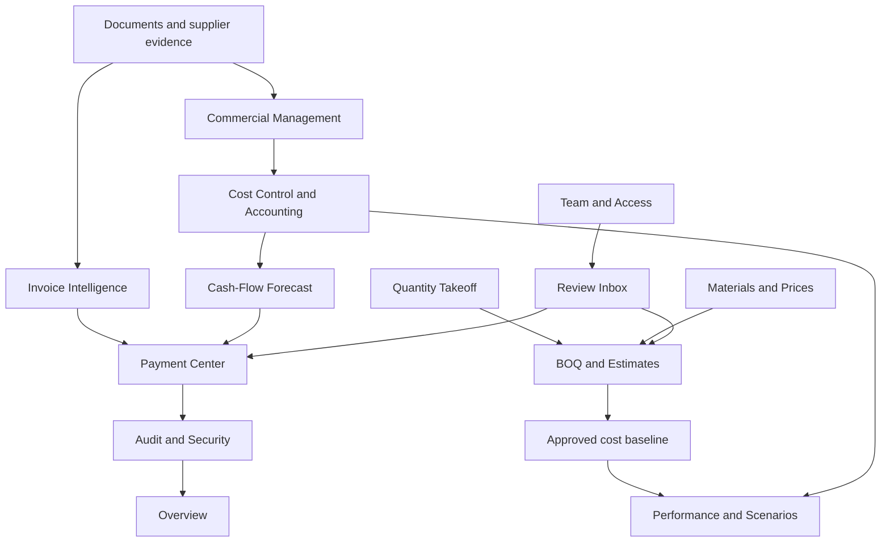
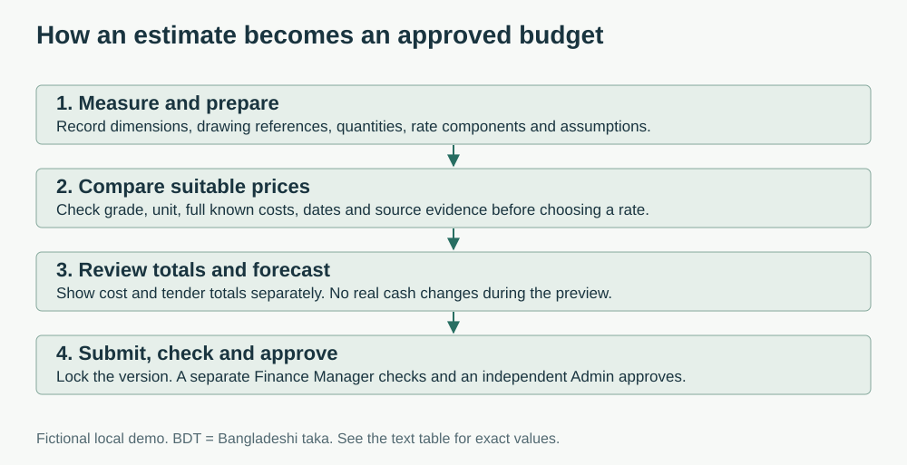
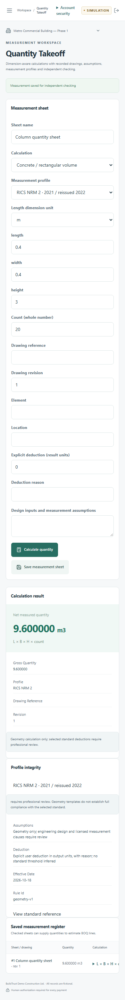
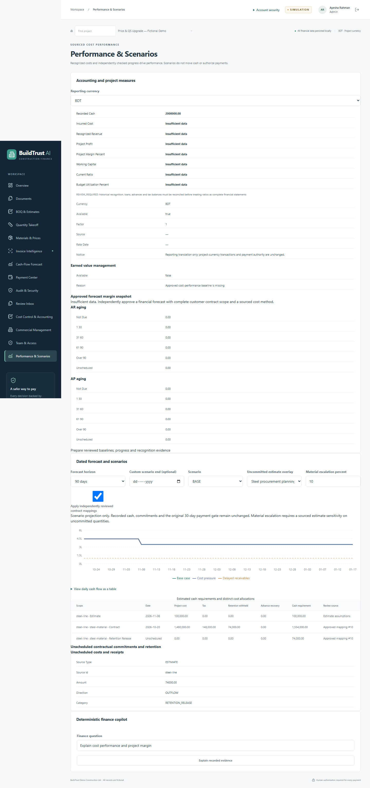
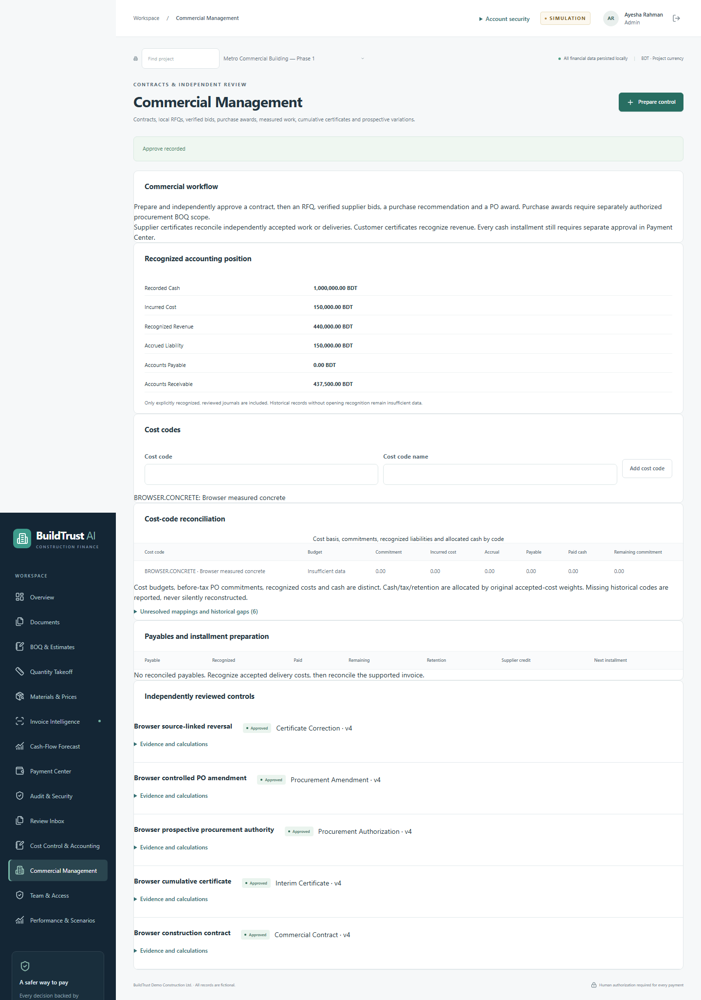
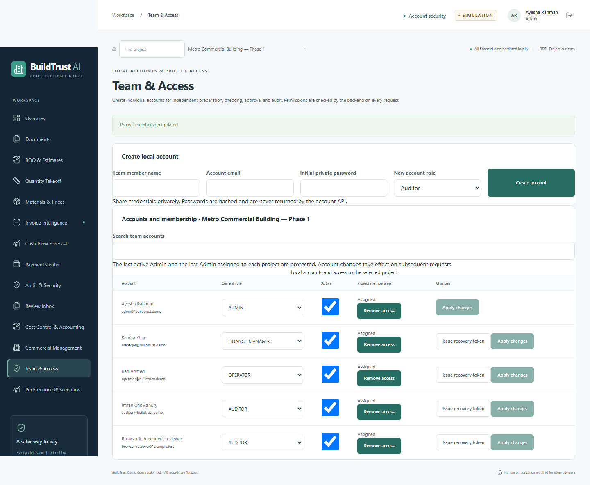

# BuildTrust AI features

BuildTrust AI is a local construction finance and estimating app. It works with fictional projects and simulated payments. This page describes the current application. [Remaining external and human tasks](docs/remaining-work.md) are listed separately.

[Try the demo and see the four passwords](README.md#try-the-public-demo) · [Documentation](docs/README.md) · [Glossary](docs/glossary.md) · [Actual test results](docs/completion-verification.md)

## The 14 application areas

**Local** means the feature works without paid services after setup. **Optional** means it needs extra configuration. **External review** means local tests do not replace real documents, credentials or qualified reviewers.

| Area | What you can do | Roles and review | Availability |
|---|---|---|---|
| **Overview** | Read saved project cash, budgets, invoice status, charts and recent events | All assigned users can read | Local |
| **Documents** | Upload PDF, CSV or JSON; view protected previews; review extracted fields and sources; retain corrections | Operator prepares; Manager/Admin confirms PO and receipts; Admin confirms BOQ and variations | Local; OCR is optional |
| **BOQ & Estimates** | Edit sections, work items and rate components; link measurements; import/export CSV/XLSX; compare revisions; print; preview forecast changes | Preparer submits; a different Manager checks; a separate Admin approves | Local; professional assumptions need review |
| **Quantity Takeoff** | Calculate concrete, reinforcement, formwork, earthworks, masonry, finishes and other supplied geometry; save drawings and deductions | Preparer saves; a different Manager/Admin checks | Local; standards claims need source evidence and professional review |
| **Materials & Prices** | Keep specifications; compare offers; review quotations; import schedules; inspect history; select eligible rates | Preparer enters/selects; independent reviewers verify quotations or equivalents | Local demo/import/history; online sources are optional |
| **Invoice Intelligence** | Compare BOQ, PO, accepted delivery and invoice; show supported quantities, rate differences and blocking findings | Operator/Manager/Admin can analyze; source confirmation stays separate | Local |
| **Cash-Flow Forecast** | Inspect daily cash, reserve, delayed receivables and cost pressure; read the matching data table | Assigned users read; reviewed records supply obligations | Local; dates and assumptions must be recorded |
| **Payment Center** | Prepare full or installment payments; reserve cash; obtain approval; execute a simulation; read receipts | Operator prepares; independent Manager/Admin approves within limits; Auditor reads | Local sandbox only |
| **Audit & Security** | Read events, receipts and history; verify the local hash chain; inspect archived runs | Assigned users read; only Admin can reset demo runs | Local; no external anchoring |
| **Review Inbox** | Find pending work, next steps, expiry warnings and first-run guidance | Project and role determine available actions | Local; no email/SMS service |
| **Cost Control & Accounting** | Review cost codes, accepted cost, accruals, invoices, liabilities, certificates, receipts, credits and retention | Operator prepares; independent Manager checks; separate Admin approves | Local; historical gaps need evidenced opening records |
| **Commercial Management** | Prepare contracts, RFQs, bids, awards, POs, work acceptances, certificates, variations, amendments and corrections | Independent checking and Admin approval; source and quantity limits apply | Local; no external RFQ messages |
| **Team & Access** | Manage users and project membership; review supplier/beneficiary changes; protect the last active Admin | Admin manages access; supplier changes need independent review | Local; real identity/beneficiary verification is human work |
| **Performance & Scenarios** | View extended forecasts, earned value, margins, aging, retention and ratios; compare sensitivity and maturity evidence | Reviewed baselines, progress and scenarios | Local; missing inputs stay unavailable |

## How the areas connect

Estimates do not replace procurement approval. Forecasts do not authorize payment. Uploaded text and AI explanations cannot grant roles or approve actions.

## Document and invoice checks

- Read actual file contents. Limit uploads to 10 MB and PDFs to 50 pages.
- Keep originals private. Show authenticated page images or escaped text previews.
- Retain document, page/row, extraction method and correction history where available.
- Detect duplicate contents, duplicate invoice identities and reused delivery quantities.
- Match project, supplier, item, specification, unit, currency and approved beneficiary.
- Normalize supported units with explicit conversions. Do not invent package weights or density.
- Limit claims by approved scope, effective PO authorization and accepted delivery.
- Show deterministic information, warnings and blocks. Do not claim a fraud-probability score.
- Treat instruction-like document text as untrusted content.

## Payment workflow and protections

| Control | What it protects |
|---|---|
| Current role and project checks | A browser cannot grant itself financial authority |
| Independent approval | The proposal creator cannot approve it |
| Exact approval snapshot | Changed amounts, sources, supplier or policy need fresh approval |
| Expiry and reservations | Rejection, expiry and invalidation release live reservations |
| Cash reserve checks | Both base and delayed-receivables scenarios must pass |
| Idempotency key | An identical retry returns the same result instead of paying again |
| Atomic transaction | Cash, allocations, payment, ledger and success audit commit together |
| Failed-attempt evidence | Failure rolls back money and retains separate evidence |

The Manager limit is BDT 100,000. The default Admin ceiling is BDT 1,000,000. Payment approval lasts 30 minutes. The minimum reserve is BDT 100,000.

| Payment example | BDT |
|---|---:|
| Opening cash | 1,000,000 |
| One approved payment | 70,000 |
| Closing cash | 930,000 |

Installments of BDT 30,000 and 40,000 reach the same closing balance. They claim accepted quantities once. A credit does not automatically refund cash or release those quantities. Retention needs a separately approved release.

## Prices, measurements and estimate approval

### Price evidence

- Keep live listings, supplier quotations, official schedules, history and synthetic prices visibly separate.
- Require exact matches or independently approved equivalents and sufficient cost/conversion evidence.
- Preserve original links, dates, specifications, charges, FX evidence and selection snapshots.
- Keep unknown freight and tax unknown rather than replacing them with zero.
- Explain recommendation weights: 50% comparable cost, 25% source evidence, 15% delivery and 10% freshness.
- Permit another eligible offer with a reason. Refresh never rewrites an earlier selection.
- Keep paid search IDs and recovery state. Never blindly repeat an uncertain paid submission.

### Measurement tools

| Group | Included calculations |
|---|---|
| Basic quantities | Area, length, count and volume |
| Concrete | Rectangular, circular, triangular prism, frustum and annular volume |
| Reinforcement | Supplied lengths/counts, sourced mass, density or labelled `D²/162` approximation; supplied schedules |
| Formwork | Column, footing, beam and slab contact areas |
| Other trades | Earthworks, backfill, disposal, compaction, masonry/openings, finishes, doors/windows, roofing and pavement |

Sheets retain drawing/revision, units, deductions, reasons, preparer and checker. Changed inputs invalidate the displayed result. No structural design, automatic reinforcement laps or unprovided standard rule is inferred.

### Estimate tools

Save quantities, cost codes, provisional items, drawings, rate components and allowance bases. Show cost and tender totals separately. Lock submitted versions and bind evidence and contributors into approval. Create a revision to change approved work. Unresolved commitment coverage stays visible instead of silently removing estimated costs.

| The 20-tonne example | Before | After |
|---|---:|---:|
| Rate, BDT/tonne | 70,000 | 74,000 |
| Estimate cost, BDT | 1,400,000 | 1,480,000 |
| Forecast cash, BDT | 600,000 | 520,000 |
| Recorded cash, BDT | 2,000,000 | 2,000,000 |

The BDT 80,000 increase changes the estimate and scheduled forecast. It does not debit cash.

## Accounting and commercial controls

| Record or workflow | Result |
|---|---|
| Accepted delivery/work | Recognize supported cost and accrued liability once |
| Verified invoice/supplier certificate | Move supported accrual into payable, retention, tax and advance accounts without repeating base cost |
| Payment | Reduce payable and recorded cash |
| Customer certificate | Recognize revenue and receivable separately from cash |
| Customer receipt | Reduce receivable and increase simulated cash |
| Credit/certificate correction | Post a bounded source-linked correction; no automatic refund |
| Accepted-cost correction | Require separate linked evidence and approval before reversing cost |
| Procurement amendment | Retire eligible unreceived scope and publish a successor PO; preserve historical rates and protected quantities |
| Contract forecast mapping | Map whole BOQ lines or specific components without overlap or repricing unrelated components |

Balanced journals, source versions, cost codes and cumulative limits connect these records. Existing POs keep contractual prices until a separately approved amendment. Missing payment or retention-release dates remain unscheduled.

## Performance, reports and operations

- Forecast 7, 30, 90 days or the recorded project duration.
- Compare material, labour, transport, FX, waste and delay scenarios with saved assumptions.
- Calculate earned-value indicators from approved cost baselines, checked progress and recognized costs. Explain missing inputs and zero denominators.
- Show actual/forecast margins, aging, retention, working capital and supported ratios.
- Keep dated reporting FX separate from settlement currency.
- Compare historical estimates and record maturity evidence without assigning an automatic AACE class.
- Use saved jobs, leases, bounded retry and restart recovery. Hold uncertain paid submissions for manual review.
- Use paginated registers, search, stable sorting, draft guards, field errors and protected downloads.
- Provide keyboard/mobile workflows, modal focus and tables alongside cash charts. Automated checks do not replace a full screen-reader assessment.

## Roles

| Role | Typical work | Independent review limits |
|---|---|---|
| Operator | Prepare documents, measurements, quotations, estimates and proposals | Cannot approve or execute payments |
| Finance Manager | Check evidence/estimates; confirm procurement; approve eligible payments | Cannot independently check retained work they contributed to; payment ceiling BDT 100,000 |
| Admin | Approve checked budgets/controls; manage access; approve eligible payments | Cannot approve retained work they prepared or checked; payment ceiling BDT 1,000,000 by default |
| Auditor | Read assigned records, calculations, receipts and audit integrity | No write or approval authority |

## Integration status

| Integration | What exists | Separate acceptance still needed |
|---|---|---|
| Synthetic catalogue | Explicit local demo offers | No live market claim |
| Supplier/reference imports | Manual entry, CSV/XLSX and reviewed PDF suggestions | Representative documents and professional checks |
| Internal history | Approved purchase and settlement context | Completeness depends on project records |
| SerpApi / DataForSEO | Bounded adapters, saved tasks and fixture tests | Credentials, paid-test authorization and live results |
| Frankfurter FX | Dated retrieval, attribution and persistence; a live USD/BDT check is recorded | Pair coverage and dates vary; old observations are not today's bank rate |
| Local OCR | Optional pinned English/Bengali models and manual fallback | Representative Bengali accuracy and layout review |
| Ollama | Optional explanation adapter and deterministic fallback | Available local model and actual live check |
| Windows/Linux/hosted CI | Passed hosted Windows/Ubuntu checks, native Linux shell startup and fresh Windows private/public setup | Results apply to the recorded source revision; see verification |
| Docker | Optional container configuration | A working engine and actual container validation are still needed |

## Real application gallery

*Quantity Takeoff: supplied dimensions, units and drawing evidence.*

*Commercial Management: reviewed scope mappings and forecast effects.*

*Certificate corrections preserve source history. Accepted-cost review stays separate.*

*Team & Access: current membership and authority.*

These screenshots come from separate fictional runs. They are not invented interface designs. See the [evidence guide](submission/execution-evidence/README.md).

## Boundaries

This app does not connect to a bank, certify a construction standard or prove a supplier's real identity. It is not a statutory accounting suite or production hosting package. A host administrator can rewrite the local audit chain. Read the [limits](docs/limitations.md), [security review](docs/security-self-assessment.md) and [remaining work](docs/remaining-work.md).
